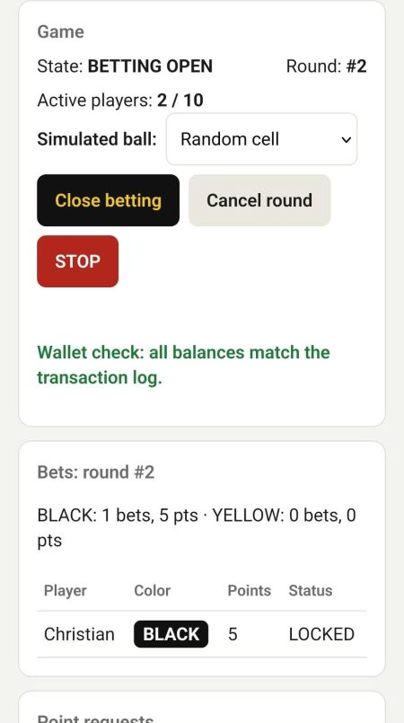
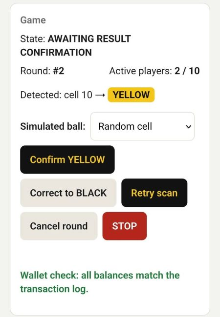
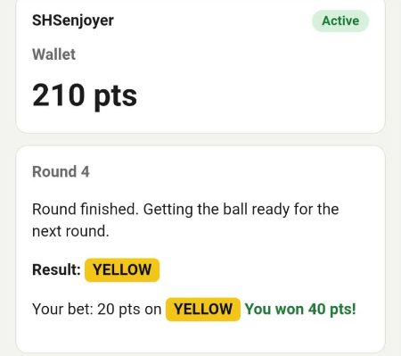
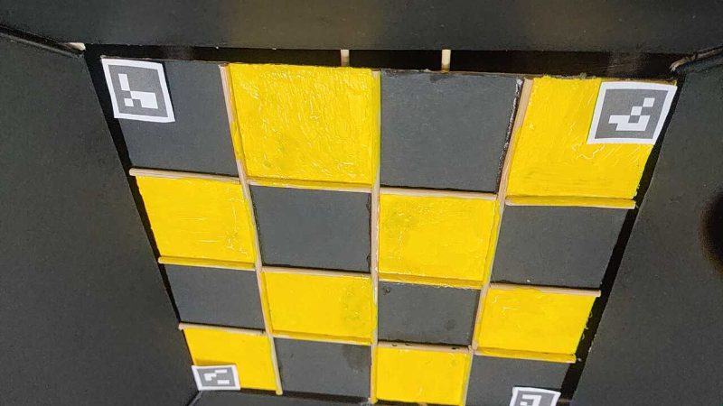
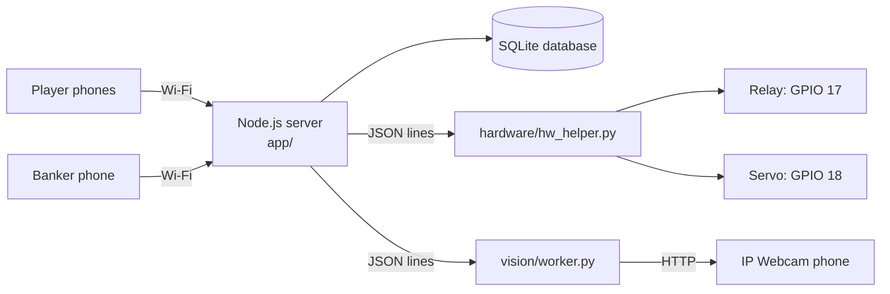

# Black or Yellow

A carnival-style betting game built on a Raspberry Pi 5 for a classroom IoT project.
Players bet points on **BLACK** or **YELLOW** from their phones, a ball drops onto a 4×4
checkerboard, a phone camera works out which colour it landed on, and winners get double
their bet.

> Points are fictional and prop money only. This is not real gambling.

| Banker page | Ball detected, waiting for the banker | Player page |
|---|---|---|
|  |  |  |

## How a round works

1. The banker opens betting. Players pick a colour and bet 5, 10, 15 or 20 points.
2. The banker closes betting. The **relay** runs for 3 seconds and the ball drops.
3. The **camera** watches the board until the ball has stayed still for 2 seconds, then
   decides BLACK or YELLOW.
4. The banker confirms (or corrects) the result. Winners are paid 2× their bet.
5. The **servo** tilts the board to 70°, waits 3 seconds and levels it again, so the ball
   rolls out for the next round.

Every player starts with 20 points. They can request more (top-up) or cash them in for
prop money (redemption), and the banker approves each request.

## Features

- Players join by scanning a QR code; no app to install (up to 10 players)
- Live updates on every phone (Socket.IO)
- Banker page with step-by-step guidance and a big STOP button
- Every point change is written to a ledger; a wallet check confirms balances match
- Survives a crash or power cut in the middle of a round (bets are refunded or settled,
  never paid twice)
- Camera finds the board from 4 printed ArUco markers, so the camera can be at an angle
  and nothing needs calibrating
- Works without hardware: the ball, relay, servo and camera can all be simulated

## Hardware

| Part | Connection |
|---|---|
| Raspberry Pi 5 (8 GB), Raspberry Pi OS Trixie 64-bit | |
| 5 V relay module (drops the ball) | VCC → pin 4 (5 V), GND → pin 6, IN → pin 11 (GPIO 17) |
| SG-5010 servo (tilts the board) | signal → pin 12 (GPIO 18), GND → pin 39, power from a separate 5 V supply |
| Android phone with the **IP Webcam** app | same Wi-Fi as the Pi, address set in `config.json` |
| 4×4 board, 45 mm cells, green-painted 30 mm ball | ArUco markers (2.25 cm) in the 4 corner cells |

The printable markers are in [`docs/board-markers-2.25cm-shortbond.pdf`](docs/board-markers-2.25cm-shortbond.pdf).



## How it fits together



The Node.js server runs the game. It starts two small Python programs and talks to them
one line of JSON at a time: one drives the relay and servo, the other reads the camera
and finds the ball. If either one crashes, the server restarts it.

## Project layout

| Folder | What's in it |
|---|---|
| [`app/`](app/) | Game server (Node.js, Express, Socket.IO, SQLite), web pages and tests |
| [`vision/`](vision/) | Ball detection with OpenCV, the live camera checker, board measurements |
| [`hardware/`](hardware/) | Relay and servo control used by the game |
| [`tools/`](tools/) | Small scripts for testing the relay, servo and camera by hand |
| [`deploy/`](deploy/) | systemd service so the game starts when the Pi boots |
| [`docs/`](docs/) | Full spec, design decisions, deploy checklist, printable markers |

## Setup

These steps are for a Raspberry Pi 5. The server and tests also run on any Linux, macOS
or Windows machine with simulated hardware.

**1. Get the code**
```bash
git clone https://github.com/alanculanculanjr-arch/black-or-yellow.git
cd black-or-yellow
```

**2. Install Node.js 24 or newer**, then the server's packages:
```bash
cd app
npm install
cd ..
```

**3. Python packages** (camera and GPIO; only needed for real hardware):
```bash
sudo apt install python3-opencv python3-lgpio
python3 -m venv --system-site-packages venv
venv/bin/pip install -r requirements.txt
```

**4. Settings**
```bash
cp config.example.json config.json
```
Edit `config.json`: set `"hardware"` and `"vision"` to `"real"` or `"sim"`, and
`"camera"` to the address shown in the IP Webcam app.

**5. Create the banker login and start**
```bash
cd app
npm run set-banker
npm start
```
Open the address it prints on a phone. Players use `http://<pi-address>:3000/`, and the
banker uses `http://<pi-address>:3000/banker` (it shows the join QR code).

To start the game automatically when the Pi boots, see [`deploy/install-autostart.sh`](deploy/install-autostart.sh).

## Settings (`config.json`)

| Key | Meaning | Default |
|---|---|---|
| `hardware` | `real` uses the relay and servo, `sim` pretends | `sim` |
| `vision` | `real` uses the camera, `sim` picks a random cell | `sim` |
| `camera` | IP Webcam address (found automatically if it changes) | |
| `dropRelaySeconds` | How long the relay runs to drop the ball | `3` |
| `tiltAngle` / `levelAngle` | Servo angles for tilting and level | `70` / `0` |
| `tiltHoldSeconds` | How long the board stays tilted | `3` |
| `detectTimeoutSeconds` | Give up looking for the ball after this long | `10` |
| `relayContacts` | `NO` or `NC`, whichever relay contact the device is wired to | `NO` |

## Testing

```bash
cd app
npm test
```
79 tests cover sign-up, points, bets, payouts, crash recovery, resets and the Python
worker link. They also run automatically on GitHub for every push.

To check the camera live while setting up the board:
```bash
venv/bin/python vision/live_check.py <camera-address>:8080 --text
```

## How the ball colour is decided

1. Find the 4 ArUco markers to locate the board (2 are enough if the ball or a hand
   covers the others).
2. Keep only green pixels and pick the roundest blob of the right size: that's the ball.
3. Correct for the camera angle, because the camera sees the side of the ball, not the
   point it touches.
4. Measure how much of the ball sits on black cells and how much on yellow. The bigger
   share wins if it's ahead by at least 20 points; otherwise the result is INVALID
   (the ball is balanced on a divider) and the banker decides.

More detail is in [`docs/adr/ADR-001-ball-cell-detection.md`](docs/adr/ADR-001-ball-cell-detection.md).

## Documentation

- [`docs/black-or-yellow-spec.md`](docs/black-or-yellow-spec.md): full requirements (125 decisions)
- [`docs/adr/`](docs/adr/): design decisions
- [`docs/deploy-checklist.md`](docs/deploy-checklist.md): steps for putting a new version on the Pi
- [`app/README.md`](app/README.md): server details and file-by-file guide

## License

[MIT](LICENSE)
